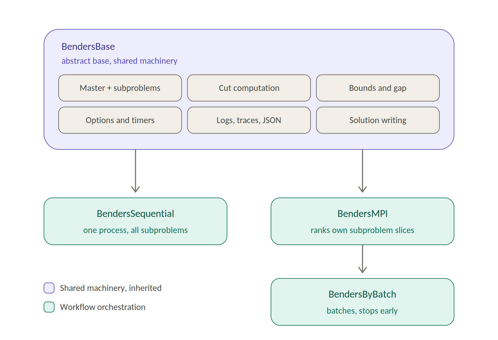
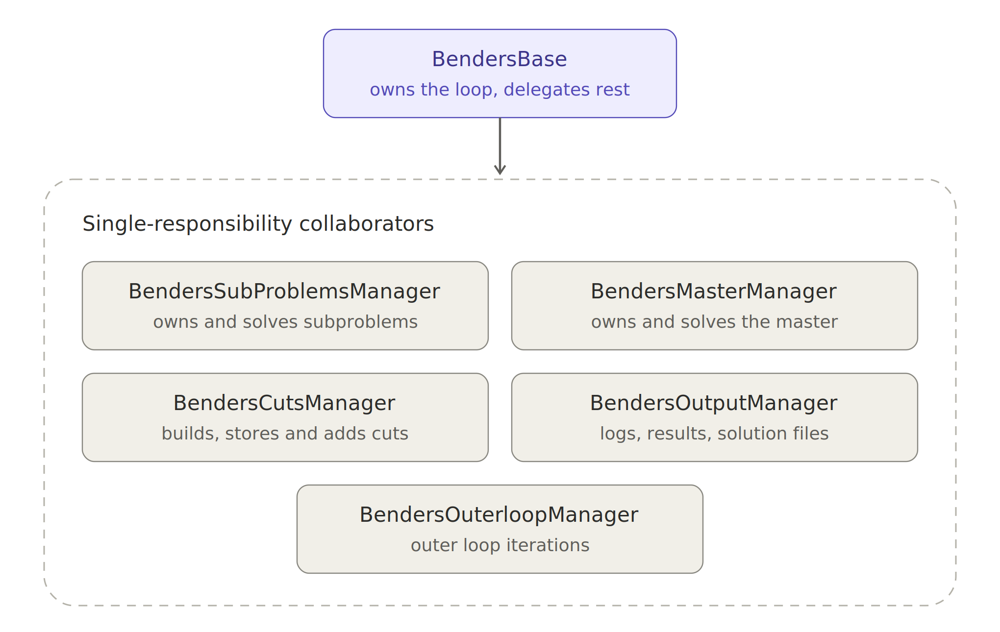

## Where we are today

The kernel currently has three implementations. `BendersSequential` inherits from `BendersBase`, `BendersMPI` inherits from `BendersBase`, and `BendersByBatch` inherits from `BendersMPI`.

`BendersBase` is the parent class and the centre of gravity. It owns the master problem and the subproblem map, the cut computation and aggregation, the bound and gap bookkeeping, the stopping criteria, option handling, timers, and everything I/O-shaped: console logs, the iteration trace, JSON output, and writing the final solution. Its subclasses call into it; it does not call much back.

`BendersSequential` is the simplest workflow. One process runs the whole loop: solve the master, walk every subproblem in turn, collect each cut, update the bounds, check convergence. No communication layer, so it also serves as the reference implementation the others are compared against.

`BendersMPI` runs the same loop, distributed. Rank 0 solves the master and broadcasts the trial investment vector, each rank solves only the subproblems it owns, and the cuts and aggregated bound come back through collective calls before the master is re-solved. The algorithm is unchanged; what it adds is partitioning, collectives, and synchronisation points.

`BendersByBatch` is a different iteration policy layered on the MPI one. Instead of solving every subproblem before touching the master, it splits them into batches and processes batches until the accumulated information already justifies re-solving the master, then stops early. It reuses the MPI communication substrate and overrides the loop that decides how much work an iteration does.

## Why this needs to change

None of the above is the result of a bad decision. It is the result of many locally reasonable ones. Each new capability was added by extending whatever class was closest to hand, and the structure we have is the accumulation of those extensions rather than a design anyone would choose today. 

**`BendersBase` is a god class.** Cut algebra, solver lifecycle, convergence policy, logging, serialisation, and instrumentation all live in one type. They change for entirely different reasons and at entirely different rates, but they share a header, a translation unit, and a mutable state. Touching cut computation means recompiling and re-reasoning about everything else.

## The new design

### `BendersBase` becomes an orchestrator

Everything that is not the loop moves out into collaborators with a single responsibility each.

- **`BendersCutsManager`** manages the creation and assembly of Benders cuts from subproblem dual solutions, including computation of separation points (xcut), aggregation of costs, and broadcasting cut data across ranks.
- **`BendersSubProblemsManager`** handles creation, storage, distribution, and solving of subproblems across multiple cache modes, with support for parallel execution, basis management, and problem-to-id mapping.
- **`BendersMasterManager`** manages the master LP problem lifecycle including variable/constraint management, objective function updates, and feeding cuts to the solver.
- **`BendersOutputManager`** orchestrates logging, CSV trace output, iteration data conversion, and result serialization throughout the algorithm and at completion.
- **`BendersOuterLoopManager`** manages the outer loop execution including criterion computation, solution tracking, and coordination between Benders iterations and outer loop objectives.

Some of these collaborators come in several implementations, one per Benders algorithm: `BendersCutsManager` and `BendersSubProblemsManager` each have a `Sequential`, an `Mpi` and a `ByBatch` variant, matching `BendersSequential`, `BendersMPI` and `BendersByBatch`. The others are shared by all algorithms. Each algorithm plugs its own variants into `BendersBase`, so what differs between algorithms lives in these collaborators rather than in the inheritance chain.

`BendersBase` keeps only the loop: ask the subclass for its iteration, feed the results through the collaborators, check whether to continue. It coordinates; it no longer computes.

## What this buys us

**The algorithm becomes testable.** Cut construction, gap computation, and stopping rules can each be unit tested against a fake or a fixture, with no solver and no filesystem. Failures become specific instead of "the end-to-end run diverged".

**Adding a variant costs one class.** A new execution strategy is a new sibling that implements the iteration and reuses every collaborator unchanged. Today it would mean deciding which existing class to inherit from and inheriting whatever else came with it.

**Changes stay local.** Changing the aggregation rule touches `BendersCutsManager` for example. 

**Collaborators are independently replaceable.** Because each one is reached through a narrow interface, alternative implementations (a different stopping rule, a different output format) become substitutions rather than edits to shared code.

**The code explains itself.** A newcomer can read `BendersBase` and see the algorithm as a sequence of named steps, then go one level deeper only into the step they care about.
