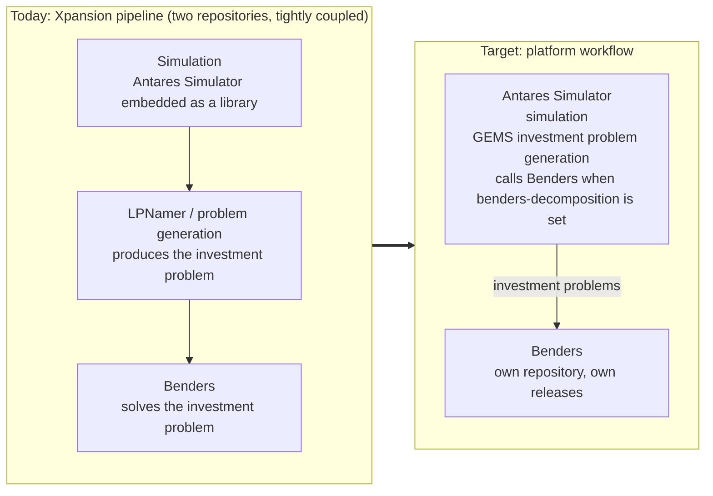
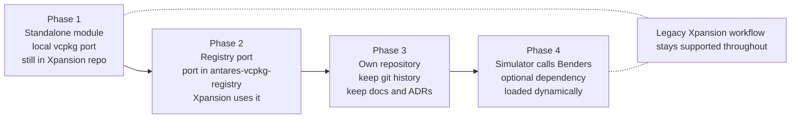
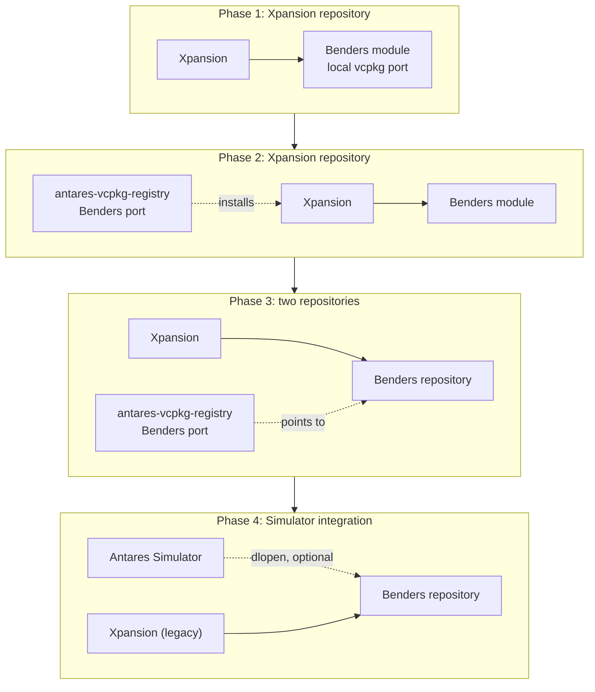
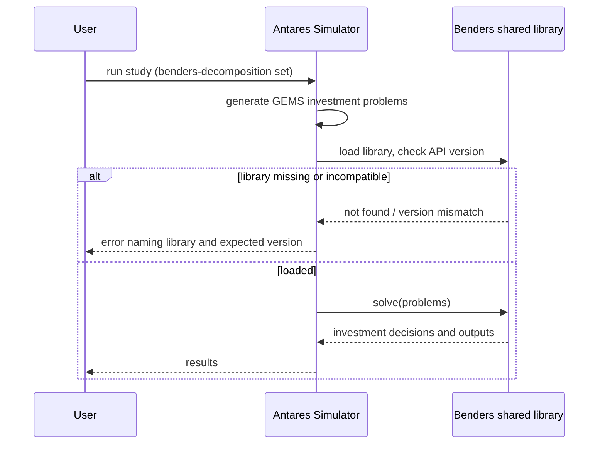

# Retire Xpansion as a product and extract Benders into its own repository

## Status

Proposed

## Context

Xpansion is an ETL pipeline with three steps:

1. **Simulation**: Antares Simulator builds the study. It started as a standalone executable. Since version 1.8.0 it is
   embedded as a library, which avoids writing files to disk (see [012]).
2. **Problem generation (LPNamer)**: turns the simulator's problems into named investment problems.
3. **Benders**: solves the investment problem by decomposition.

The library integration tightened the coupling: Xpansion depends on Simulator internals, and the code is split across
two repositories that must move together.

Two shifts make two of the three steps redundant inside Xpansion:

- LPNamer is being replaced.
  [GEMS investment problems](https://gems-energy.readthedocs.io/en/latest/user-guide/input-files/optimization-configuration/)
  and Benders decomposition are being added to Antares Simulator. Simulator will then produce problems ready for Benders,
  as if LPNamer had run.
- Benders is already used standalone by several teams, outside Xpansion.

So simulation and problem generation both belong to Antares Simulator, and Benders is effectively a dependency of
Xpansion, not a component.

## Decision

We retire Xpansion as a standalone product and favour a platform workflow:

- Benders stays a maintained project, in its own repository.
- Every other Xpansion responsibility moves either into Antares Simulator or into tooling (see the feature inventory
  below).
- The legacy Xpansion workflow stays supported while users move to the new one.

### Target architecture

Remaining Xpansion roles (launcher, study update, sensitivity and so on) go to tooling, see the inventory below.

| | Today | Target |
| --- | --- | --- |
| Simulation | Antares Simulator, embedded as a library in Xpansion | Antares Simulator |
| Problem generation | LPNamer in Xpansion | GEMS investment problems, generated by Antares Simulator |
| Solve | Benders in Xpansion | Benders, own repository and releases, called by Antares Simulator when benders-decomposition is set |
| Repositories | Two, tightly coupled | Benders is a dependency of Simulator; remaining Xpansion roles go to tooling |

### Transition plan

Phases 1 to 3 only change packaging and repository layout. Phase 4 is the first one that changes how users solve
investment problems. The legacy Xpansion workflow stays supported throughout.

Where the code lives at each phase:

1. **Standalone module.** Make Benders a standalone module inside the Xpansion repository and create a local vcpkg port
   for it.
2. **Registry port.** Add the Benders port to
   [antares-vcpkg-registry](https://github.com/AntaresSimulatorTeam/antares-vcpkg-registry), with Benders still inside
   the Xpansion repository, and make Xpansion use it.
3. **Own repository.** Move Benders into a dedicated repository. Keep the git history if possible, and keep the
   documentation and ADRs.
4. **Simulator integration.** Develop a way to solve investment problems through Simulator. Benders becomes a Simulator
   dependency, optional at runtime. Simulator links to Benders and calls it when benders-decomposition is set.

### Loading Benders from Simulator

Benders is an optional runtime dependency of Simulator, loaded dynamically when benders-decomposition is set. Proposal,
open to suggestions:

- **Loading:** `dlopen` / `LoadLibrary` on a Benders shared library, resolving one small entry point.
- **Interface:** a C-compatible, versioned API, so Simulator and Benders release independently without C++ ABI breakage.
- **Missing library:** a clear error naming the library and the expected version.
- **Build:** a CMake option builds Simulator without any Benders support.

- **Alternative considered:** calling a separate executable through files. It is simpler, but it brings back the disk
  I/O that the library integration removed.

### Xpansion feature inventory

What the repository ships beyond the three core steps, taken from `src/cpp`, `src/python` and the `--step` options of the
launcher. The proposed owner is a starting point; the last column is for the team to fill in during review.

| Feature | Where it lives today | Proposed owner | Still relevant? |
| --- | --- | --- | --- |
| Launcher and step orchestration (`--step`: full, antares, problem_generation, presolve, benders, gems, study_update, sensitivity, resume) | `src/python/launch.py`, `input_parser.py`, `full_run_driver.py` | Thin tooling around Simulator and Benders | To decide |
| Study locking, output cleaning, resume | `study_locker.py`, `study_output_cleaner.py`, `resume_study.py` | Tooling (resume of the solve itself belongs to Benders) | To decide |
| Antares simulation step | `antares_driver.py` | Simulator | To decide |
| Problem generation (LPNamer) | `src/cpp/lpnamer`, `problem_generator_driver.py`, `candidates_reader.py` | Replaced by GEMS investment problems in Simulator | To decide |
| `gems` step (problem generator followed by Benders) | `gems_driver.py` | Simulator, once it calls Benders (phase 4) | To decide |
| Benders solvers: sequential, MPI, by batch, micro-iterations, in-memory compact subproblems | `src/cpp/benders` | Benders repository | To decide |
| Master merge and merged-problem export | `exe/merge_master`, `exe/merge` | Benders repository | To decide |
| Multi-solver interface (Cbc, Clp, Xpress and others) | `src/cpp/multisolver_interface` | Benders repository | To decide |
| Presolve step | `src/cpp/presolve`, `presolve_driver.py` | Benders repository or tooling | To decide |
| Sensitivity analysis | `src/cpp/sensitivity`, `sensitivity_driver.py` | Tooling on top of Benders | To decide |
| Study update (writes optimal capacities back to the Antares study) | `src/cpp/study-updater`, `study_updater_driver.py` | Tooling | To decide |
| Input checks (candidates, chronicles, link profiles) | `input_checker.py`, `chronicles_checker.py`, `profile_link_checker.py`, `split_link_profile.py` | Simulator or tooling | To decide |
| Trajectory investment (multi-year tree: merge weights, merge master, multiple problem generation) | `src/python/antares_xpansion/trajectory`, `src/cpp/merge_weights_trajectory`, `exe/multiple_problem_generation` | Undecided: own project or tooling | To decide |
| Outer loop | `exe/outer_loop` | Undecided | To decide |
| Antares archive updater | `exe/antares_archive_updater` | Tooling | To decide |
| Packaging and release (PyInstaller launcher, installers, docker) | `antares-xpansion-launcher.spec`, `docker/` | Retired with Xpansion; Benders gets its own release pipeline | To decide |

## Consequences

- Benders is built, versioned and released independently, and can keep being used standalone.
- Antares Simulator can produce investment problems ready for Benders without LPNamer.
- Each responsibility has a single owner, and the hard coupling between the two repositories goes away.
- The legacy workflow must keep working while Simulator's own investment support matures, so phases 1 to 3 change no
  behaviour.
- Risks and mitigations:

| Risk | Mitigation |
| --- | --- |
| Legacy Xpansion users broken by the split | Xpansion keeps consuming Benders through the same port; no behaviour change until phase 4 |
| Benders history lost in the move | Extract with history-preserving tooling (for example `git filter-repo`); verify before archiving |
| Docs and ADRs left behind | Move them with Benders; leave pointers in Xpansion |
| Simulator and Benders versions drift | Pin versions through the vcpkg registry; add a compatibility matrix |
| Gap between LPNamer output and GEMS-generated problems | Compare results on the existing end-to-end studies before switching a workflow |

## Open questions

- Who owns the remaining Xpansion tooling, and where does it live? First decide which features of the inventory are still
  relevant.
- What is the support window and end-of-life date for the legacy Xpansion workflow?
- Name, license and release cadence of the new Benders repository.
